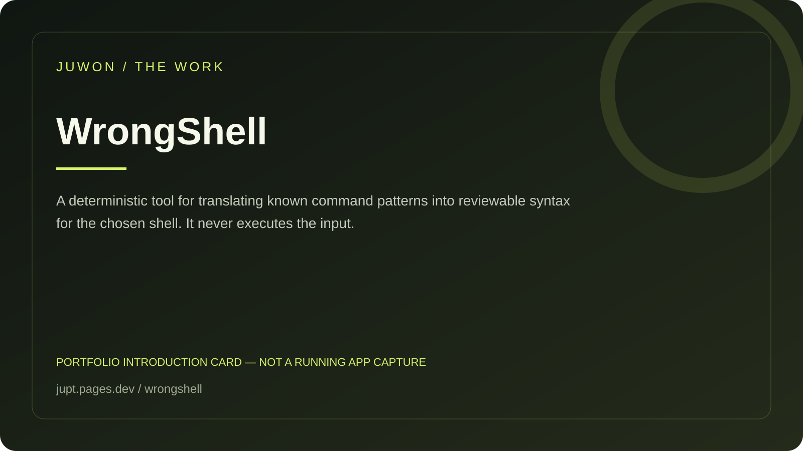

<!-- JUWON-PORTFOLIO-INTRO:START -->
# WrongShell



*Portfolio introduction card, not a screenshot of a running application.*

*포트폴리오 소개 카드입니다. 실행 화면 캡처가 아닙니다.*

## English

A deterministic tool for translating known command patterns into reviewable syntax for the chosen shell. It never executes the input.

[View JUWON's portfolio](https://jupt.pages.dev/) · [Browse the project collection](https://jupt.pages.dev/projects)

**Scope:** This README presents the repository's documented intent and recorded visual evidence. It does not certify that every feature is complete, deployed, or currently working. Follow the original setup, safety, and license documentation below.

## 한국어

복사한 명령을 실제 사용할 셸에 맞춰 검토 가능한 형태로 바꾸는 도구.

[JUWON 포트폴리오 보기](https://jupt.pages.dev/) · [전체 프로젝트 보기](https://jupt.pages.dev/projects)

**확인 범위:** 저장소의 문서상 목적과 기록된 화면 근거를 소개합니다. 모든 기능의 완성·배포·현재 정상 작동을 보증하지 않습니다. 설치법·안전 주의사항·라이선스는 아래 기존 문서를 확인하세요.
<!-- JUWON-PORTFOLIO-INTRO:END -->

---

## Original documentation / 기존 문서

# WrongShell

## Your AI command isn't wrong. Your shell is.

WrongShell turns a command copied from ChatGPT, Claude, Copilot, or a README into a
reviewable command for the shell you actually use. It explains each known change,
stops when syntax is uncertain, and never runs the input.

```text
copy command -> WrongShell -> see the translation -> review -> run yourself
```

### The five-second fix

```powershell
python -m pip install https://github.com/juwonllee2024-dotcom/wrongshell/releases/download/v0.1.0/wrongshell-0.1.0-py3-none-any.whl
wrongshell --shell powershell "npm ci"
```

```text
WRONGSHELL command report
Status: READY
Source: POSIX shell
Target: PowerShell

Original:
npm ci

Translated (review before running):
npm.cmd ci

Why:
  [INFO] PS-NPM-SHIM: PowerShell can resolve npm.ps1 first. The .cmd shim avoids
  changing execution policy just to run a package command.
```

That small `.cmd` change is useful on Windows when PowerShell refuses to load
`npm.ps1`. It avoids weakening execution policy for a package-manager command.

## Why this exists

AI coding answers often assume Bash while the person asking is in PowerShell,
Command Prompt, WSL, or a macOS terminal. The command looks plausible until the
shell interprets it differently. Existing translators can hide the reasoning or
depend on a model. WrongShell is a tiny deterministic lens: it shows the input,
the proposed output, and the reason for every transformation.

## Use it with a pasted block

```powershell
wrongshell --from-shell bash --shell powershell --file .\examples\ai-command.txt
wrongshell --shell powershell --format json "export MODE=demo; npm run build"
wrongshell --shell powershell --format markdown "rm -rf ./dist"
```

Omit the command to read from standard input:

```powershell
Get-Clipboard | wrongshell --shell powershell
```

WrongShell does not read the clipboard itself. The shell pipe is an explicit
choice by you, and the command is still only inspected.

## What the first version translates

- `npm`, `npx`, `pnpm`, and `yarn` to their Windows `.cmd` shims.
- POSIX `export NAME=value` to PowerShell `$env:NAME="value"`.
- Common file and navigation commands such as `rm`, `cp`, `mv`, `cat`, `pwd`,
  `which`, and `mkdir -p` to readable PowerShell equivalents.
- Common PowerShell environment, file, and package-manager forms back to POSIX
  equivalents.
- Recursive deletion, network-to-shell pipes, credential-like paths, and
  dynamic evaluation as review signals instead of pretending they are safe.

Unknown command substitution, dynamic evaluation, and shell-specific syntax are
left alone and marked `MANUAL`. A translation is a suggestion, not a security
boundary or a promise that the command will succeed.

## Privacy and safety boundary

- No account, model, API key, telemetry, or network call.
- No shell, subprocess, installer, file write, or command execution.
- A file is read only when you explicitly pass `--file`.
- Reports can echo the command you provide. Treat output containing secrets as
  sensitive and do not publish it.
- WrongShell cannot detect every dangerous command. Review the translated text
  and the target path yourself before running it.

## Install from source

Python 3.10 or newer is supported.

```powershell
git clone https://github.com/juwonllee2024-dotcom/wrongshell.git
cd wrongshell
python -m pip install -e ".[dev]"
python -m unittest discover -s tests -v
```

## Founder hypothesis

- First users: Windows developers who paste AI-generated shell commands and
  contributors who move setup instructions between Bash and PowerShell.
- Value: fewer dead-end commands and fewer risky “just change the policy” fixes.
- Free model: the local CLI stays free and MIT-licensed so a user can inspect it
  before trusting it with a command.
- Revenue hypothesis: only after repeated use is proven, teams may pay for a
  private policy pack or CI integration; this MVP does not require a service.
- Seven-day experiment: ask ten developers to run five commands from their usual
  AI workflow and record whether WrongShell finds a difference they would have
  missed. Do not treat a star or a clone as proof of use.

## Project files

- [Research and hypothesis](docs/research.md)
- [Verification record](docs/verification.md)
- [Security policy](SECURITY.md)
- [Contributing guide](CONTRIBUTING.md)
- [Changelog](CHANGELOG.md)

## License

MIT. See [LICENSE](LICENSE).
